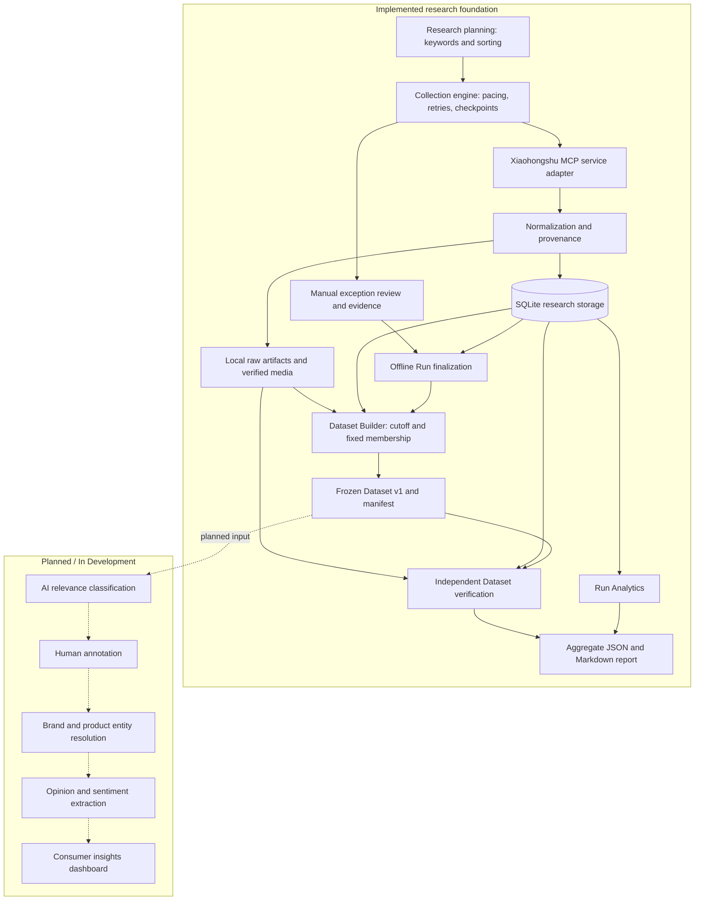

# MarketLens — AI-Driven Consumer Insights Platform

MarketLens aims to transform unstructured product discussions into structured, traceable consumer insights for product research, market analysis, and brand intelligence.

**Current focus:** A locally validated data engineering foundation for a research-oriented AI consumer insights platform. The AI insights engine is in development.

Start with the [verified Run 1 report](docs/phase1d_xhs_baseline_collection/run1_final_report.md), its [aggregate JSON](docs/phase1d_xhs_baseline_collection/run1_metrics.json), or the [research implementation](marketlens/research/).

## Overview

Social platforms contain valuable accounts of product experiences, unmet needs, and purchasing decisions. These discussions are scattered across posts and comments, making it difficult for product managers and market analysts to compare feedback systematically and trace individual claims to their sources.

**MarketLens** is an independent software engineering project exploring how to turn these discussions into structured, auditable research data. The engineering approach preserves what was observed, how it was collected, and which observations support each dataset and report.

The implemented foundation covers configurable collection, provenance-aware storage, exception recovery, data-quality analysis, and immutable dataset versions. Its first case study examines foundation makeup discussions on Xiaohongshu. The next phase will build AI-assisted relevance assessment, product identification, and opinion extraction on this foundation.

## Key Features

Implemented in the research pipeline:

- **Traceable collection:** keyword x sort search plans, deduplicated candidate identities, detail snapshots, comment/reply observations, and retained request attempts and raw artifacts.
- **Controlled execution:** request pacing, bounded retries, persisted checkpoints, explicit resume paths, and evidence-backed manual handling of exceptional tasks.
- **Verified media:** content-addressed image storage with SHA-256, file-size, and decoded image-dimension checks.
- **Offline finalization:** explicit Run sealing with validated decisions and synchronized checkpoint evidence.
- **Frozen datasets:** deterministic Dataset v1 selection, immutable membership, canonical manifests, and independent verification.
- **Reusable reporting:** Run Analytics P0 and a shared JSON-to-Markdown renderer for sampling, coverage, data quality, reliability, and frozen-member statistics.

## System Architecture



SQLite holds authoritative research records; local artifacts and review evidence support traceability. Finalization seals a Run before dataset freezing. Reporting combines Run Analytics with verified frozen-member statistics, whose selection rules remain distinct. The Streamlit product explorer is a separate legacy demo.

## Case Study: Foundation Makeup Discussions

Across **50 keyword and sorting combinations**, the first formal Xiaohongshu baseline collected **462 image-text posts** and **10,246 comment and reply observations**. Dataset v1 was frozen and independently verified against its source records and supporting files. The [Run 1 report](docs/phase1d_xhs_baseline_collection/run1_final_report.md) and [aggregate metrics](docs/phase1d_xhs_baseline_collection/run1_metrics.json) document the full sampling design and results.

This is a finite, search-selected sample with incomplete comment coverage; it does not support platform-wide or market-wide estimates. The Run was sealed as `partial` with documented unavailable posts. Original research data is not distributed, so external readers can inspect the aggregate results and generation method but cannot independently verify the collected sample from this repository alone.

## Engineering Highlights

- **Track observations without overwriting history.** Post identities are separate from Snapshots, and Comment identities from Observations, so repeated collection can retain changes and their source attempts.
- **Recover with explicit state and limits.** Persistent task state, bounded retries, and checkpoint recovery support resuming interrupted work while preserving attempt budgets. Uncertain failures require review before further collection.
- **Keep failures explainable.** Failed Attempts remain in the history. Manual exception decisions bind to task evidence, distinguishing confirmed source deletion, reviewed restrictions, and unresolved timeouts without guessing their causes.
- **Make dataset versions verifiable.** An explicit selection cutoff and immutable membership fix the observations used in a version. Manifest verification checks members and supporting file hashes; publication failure recovery accepts only matching saved intents.
- **Reuse analysis with clear definitions.** Run Analytics and the shared JSON/Markdown report pipeline separate collected observations from frozen dataset members. Missing values and incomplete coverage remain visible rather than becoming misleading counts.
- **Validate failure behavior with synthetic data.** Tests inject publication failures and corrupt artifacts to exercise recovery and integrity checks. Read-only verification and scope-isolation checks help protect research evidence during analysis.

Useful entry points: [collector](marketlens/research/baseline_collector.py), [finalization](marketlens/research/run_finalization.py), [Dataset Builder](marketlens/research/dataset_builder.py), [Run Analytics](marketlens/research/run_metrics.py), and [report generator](marketlens/research/run_report.py).

## Technology Stack

| Layer | Current implementation |
| --- | --- |
| Language and storage | Python 3.11+, SQLite via `sqlite3`, SQL constraints and triggers |
| Collection | Python orchestration and a Xiaohongshu MCP service adapter |
| Integrity and media | SHA-256, canonical JSON manifests, Pillow image validation |
| Reporting | Python aggregate analysis, JSON, Markdown |
| Testing | pytest with synthetic responses and temporary databases |
| Legacy UI | Streamlit and pandas for a synthetic product explorer |

The implemented offline research analysis does not require an LLM API key. Collection requires a separately configured service and access context; installing Python dependencies alone does not enable live collection.

## Repository Structure

```text
marketlens/
|-- marketlens/
|   |-- adapters/               # Collection service adapter
|   |-- research/               # Collection, storage, freeze, verification, reporting
|   |-- repository.py           # Legacy product queries
|   |-- product_service.py      # Legacy product search and statistics
|   |-- ingest.py               # Legacy CSV importer
|   `-- charts.py               # Legacy chart preparation
|-- scripts/                    # Research collection command entry points
|-- tests/                      # Unit and integration tests
|-- docs/                       # Schemas, reports, operating notes, design history
|-- examples/                   # Synthetic demo data
|-- local_data/                 # Git-ignored research data and local evidence
|-- app.py                      # Legacy Streamlit product explorer
`-- requirements.txt
```

## Getting Started & Testing

Start by setting up a development environment and running the synthetic tests. From the repository root, using PowerShell and Python 3.11+:

```powershell
py -3.11 -m venv .venv
.\.venv\Scripts\python.exe -m pip install -r requirements.txt
.\.venv\Scripts\python.exe -B -m pytest tests -q
```

Tests use synthetic responses and temporary databases, so the private research dataset is not required. Coverage includes collection and retry behavior, data normalization, scope isolation, read-only analysis, dataset immutability, corrupted-artifact detection, publication recovery, and report consistency.

To explore the implementation, start with [research modules](marketlens/research/) and their [tests](tests/research/). Live collection has separate service and access prerequisites described in the [formal collection guide](docs/phase1d_xhs_baseline_collection/formal_collection.md).

<details>
<summary>Optional: run the legacy Streamlit product demo</summary>

This earlier demo displays synthetic product listings and prices; it is separate from the consumer insights engine. In a fresh checkout without an existing `marketlens.db`, run:

```powershell
.\.venv\Scripts\python.exe -m marketlens.ingest examples/demo_synthetic.csv
.\.venv\Scripts\python.exe -m streamlit run app.py
```

The importer creates the local demo database.

</details>

## Reproducibility & Data Availability

- **Inspect the code and run synthetic tests.** Collection controls, the SQLite schema, Dataset Builder, and analytics are available to readers with repository access. Synthetic tests exercise the engineering logic without the private research database or account access.
- **Recreate the report from saved aggregates.** The [aggregate JSON](docs/phase1d_xhs_baseline_collection/run1_metrics.json) can be rendered into the [Markdown report](docs/phase1d_xhs_baseline_collection/run1_final_report.md) using `render_markdown()` in the [report generator](marketlens/research/run_report.py). This reproduces presentation of saved results; independently recalculating them requires the original data.
- **Keep original research data local.** The research database, raw content, media, and authentication material are not distributed, to protect personal information and avoid redistributing source content without appropriate rights.

Dataset versions and manifests support reproducibility within the controlled local research environment, where the original records and evidence are available. They do not establish source-data redistribution rights. Full local reproduction requirements are documented in the final report.

## Roadmap

| Capability | Status |
| --- | --- |
| Research collection, normalization, verified media, and offline Run sealing | Implemented and locally validated |
| Dataset v1 freeze and manifest verification | Implemented; formal Run 1 dataset frozen |
| Run Analytics P0 and reproducible aggregate reports | Implemented and locally validated |
| AI Relevance / Research Value Classification | **In Development** |
| Human-in-the-Loop Annotation | **In Development** |
| Brand and Product Entity Resolution | **In Development** |
| Aspect-level Sentiment and Opinion Extraction | **In Development** |
| Consumer Insights Dashboard | **In Development** |

"In Development" identifies the next-stage roadmap, not a delivered or evaluated capability. Existing manual collection-exception review is not an implemented annotation workflow. Model accuracy and downstream insight quality have not yet been established.

## Technical Documentation

- [Run 1 final report](docs/phase1d_xhs_baseline_collection/run1_final_report.md) and [aggregate metrics](docs/phase1d_xhs_baseline_collection/run1_metrics.json) - current baseline results and reproduction parameters.
- [Dataset Builder](marketlens/research/dataset_builder.py) and [Run Analytics](marketlens/research/run_metrics.py) - version selection, verification, and reusable metric definitions.
- [Research SQL schema](docs/phase1b_collection_dataset_schema/schema/marketlens_phase1b_schema_v0_2_1_candidate.sql) and [ERD](docs/phase1b_collection_dataset_schema/schema/marketlens_phase1b_erd_v0_2_1_candidate.dbml) - storage contracts.
- [Storage layout](docs/phase1d_xhs_baseline_collection/storage_layout.md) and [integration report](docs/phase1d_xhs_baseline_collection/storage_integration_report.md) - provenance and media persistence.
- [Detail pacing](docs/phase1d_xhs_baseline_collection/detail_pacing_report.md), [bounded retries](docs/phase1d_xhs_baseline_collection/detail_retry_report.md), and [pending review](docs/phase1d_xhs_baseline_collection/pending_review_report.md) - operational controls.
- [Local finalization](docs/phase1d_xhs_baseline_collection/local_finalization.md) - sealing decisions and verification.
- [Work log](docs/WORK_LOG.md) - chronological implementation and validation history.
- [Original product specification](docs/PRODUCT_SPEC.md), [architecture proposal](docs/TECHNICAL_ARCHITECTURE.md), and [implementation plan](docs/IMPLEMENTATION_PLAN.md) - historical shopping-assistant design context, not current feature-completion claims.
- [Data source register](docs/DATA_SOURCE_REGISTER.md) - historical source-access review; it predates the implemented collector and is not evidence of current collection or redistribution permission.

Historical reports describe their own validation stages. Use the final Run 1 report and current source code for the completed baseline rather than treating earlier "not yet collected/frozen" notes as its current state.
