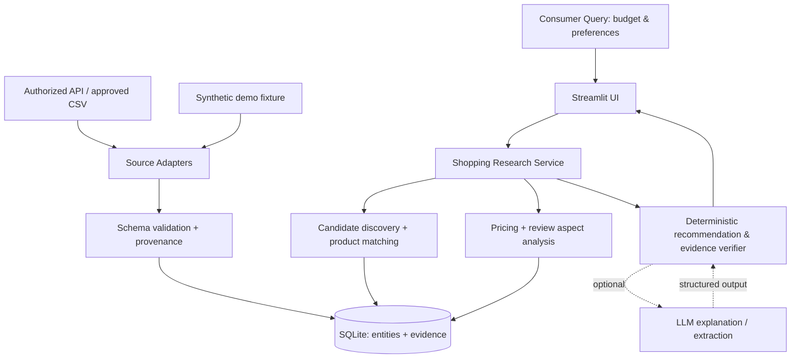

# MarketLens — Technical Architecture & Data Contracts V1.0

> 此文档规定 V0.1 的实现边界和未来扩展接口；字段是**设计契约**，与当前旧版 `marketlens/ingest.py` 并不完全一致，需要逐步迁移。

## 1. 技术选型

- Python 3.11+；标准库优先，类型注解；Pydantic 用于边界输入校验；SQLite 作为 MVP 存储（可先用内置 sqlite3，后续视复杂度使用 SQLAlchemy）。
- Pandas 用于分析（按需）、Streamlit + Plotly 用于单进程 Web 原型、pytest 用于测试。
- LLM 为**可选适配器**。无 Key、接口失败、模型输出无效时，系统不崩溃，返回确定性分析/证据不足。
- 暂不必引入 LangGraph、FastAPI、React、Redis、Docker 或分布式队列。这些只在真实需求出现时评估。

## 2. 逻辑架构



**设计原则**：UI 不访问爬虫；分析函数不依赖 HTTP；LLM 不允许直接访问数据库或执行任意 SQL；每个数据源通过 adapter 返回统一的经验证记录。未来加平台只增加 adapter，不重写推荐引擎。

## 3. 按层划分模块

```text
marketlens/
  __init__.py
  config.py                 # 本地配置、环境变量、路径
  domain/
    schemas.py              # Pydantic 输入、核心输出/枚举
    normalization.py        # 品牌/单位/价格/时间归一
  storage/
    db.py                   # 连接、事务、迁移入口
    repository.py           # 对 entities / evidence 的读写
    migrations/             # 有版本的 SQL 迁移
  ingestion/
    csv_importer.py         # 来源校验和批量导入
    adapters/
      base.py               # SourceAdapter Protocol（声明来源及授权范围）
      csv_adapter.py        # 本地 CSV
      official_api_stub.py  # 未获批准时仅返回 NotConfigured
  services/
    discover.py             # 从已有来源记录搜索候选
    product_matching.py     # 品牌+名称+规格匹配、人工确认
    aspect_analysis.py      # 规则/人工 aspect 标签聚合
    pricing.py              # 价格/容量/货币/套装比较
    recommendation.py       # 确定性过滤/解释/弃权
    evidence.py             # 来源关联与主张检查
    shopping_flow.py        # 端到端串联
  ai/
    interface.py            # 可选 LLM 抽取/说明接口
    noop.py                 # 无 Key 回退
  ingest.py                 # **旧入口兼容层**；先保留
app.py                    # Streamlit UI
examples/
  demo_synthetic.csv       # 旧价格示例，仅合成
  demo_consumer/           # 可检查、匿名的合成社交/零售关系样本
  templates/               # 手工导入 CSV 列模板，无真实数据
scripts/
  init_db.py
  ingest_consumer.py
  check_data.py
tests/
  fixtures/
  test_ingest.py           # 保留旧版回归测试
  test_products.py
  test_matching.py
  test_price.py
  test_evidence.py
  test_shopping_flow.py
  test_app_smoke.py

AGENTS.md                   # Codex 工作边界
README.md                   # 真实完成情况与运行方法
docs/
  PRODUCT_SPEC.md
  TECHNICAL_ARCHITECTURE.md
  IMPLEMENTATION_PLAN.md
  DATA_SOURCE_REGISTER.md
  BACKLOG.md
  WORK_LOG.md
```

项目初始代码仍是旧 V0.0：仅简单 SKU/历史价导入与搜索。这份目录是**建议迁移后的目标结构**，不可在 README 里宣称已实现。

## 4. SQLite 实体设计（建议）

**所有主键内部用整数或 UUID；原平台 ID 作为字符串保存。**

### 4.1 `brands`
- `id` PK, `canonical_name` NOT NULL UNIQUE, `aliases_json` TEXT, `created_at`。

### 4.2 `products`（规范化“产品”而非店铺出售链接）
- `id` PK, `brand_id` FK nullable, `canonical_name` NOT NULL, `category` NOT NULL,
  `variant` TEXT, `size_value` REAL nullable, `size_unit` TEXT nullable (`ml`, `g`, `unit`),
  `pack_count` INTEGER nullable, `identity_status` (`verified`/`candidate`/`ambiguous`), `created_at`。
- 不要只靠商品标题建立唯一约束；同品牌不同容量、不同版本必须有独立 product ID 或明确变体关系。

### 4.3 `listings`（电商平台上架条目）
- `id` PK, `product_id` FK nullable（待匹配时允许为空）, `platform`, `external_listing_id`, `url`,
  `seller_name` nullable, `title_raw`, `currency`, `listed_size_value`, `listed_size_unit`, `listed_pack_count`,
  `match_status` (`verified`/`candidate`/`unmatched`), `first_seen_at`。
- 唯一键：(`platform`, `external_listing_id`)；缺少平台 ID 时规范化 URL 但不可鲁莽合并。

### 4.4 `price_snapshots`
- `id` PK, `listing_id` FK, `observed_at` timezone-aware ISO, `price_amount` REAL nullable, `currency`,
  `price_kind` (`listed`/`sale`/`coupon_conditional`/`unknown`), `shipping_included` nullable,
  `raw_price_text` TEXT, `source_record_id` FK, `created_at`。
- 一次采集时间不应被当成统一到手价；同 listing 同时刻同来源重复导入采用幂等键，后续时间保留历史。

### 4.5 `social_posts`
- `id` PK, `platform`, `external_post_id`, `url`, `title` nullable, `excerpt` nullable, `published_at` nullable,
  `observed_at`, `sponsored_status` (`yes`/`no`/`unknown`), `source_record_id` FK。
- 唯一键：(`platform`, `external_post_id`)。不要在 GitHub 或公共数据库中默认存入未经许可的评论全文、账号信息。

### 4.6 `post_product_mentions`（多对多）
- `id` PK, `post_id` FK, `product_id` FK nullable, `mention_raw`, `match_method`,
  `match_score` REAL nullable, `review_status` (`verified`/`candidate`/`rejected`), `source_record_id` FK。
- 一篇笔记可能同时提到多个产品，一条提及也可能有歧义；`match_score` 初期是启发式分数，**不能称为校准的概率**。

### 4.7 `purchase_reviews`
- `id` PK, `listing_id` FK, `external_review_id` nullable, `excerpt` nullable, `rating` nullable,
  `reviewed_at` nullable, `observed_at`, `source_record_id` FK, `is_verified_purchase` nullable。
- 不存消费者可识别信息；没有评分就是 `NULL`，不能填 0。

### 4.8 `aspect_observations`
- `id` PK, `evidence_kind` (`social_post`/`purchase_review`), `evidence_id`, `product_id` FK nullable,
  `aspect` (`lightweight_feel`, `greasy_feel`, `scent`, `packaging`, `price`, `other`),
  `polarity` (`positive`/`negative`/`mixed`/`neutral`/`unknown`),
  `method` (`manual`/`rules`/`llm`), `short_supporting_excerpt` nullable, `created_at`。
- `evidence_kind`+`evidence_id` 须经业务层验证存在，不许凭空生成证据。

### 4.9 `source_records`（来源与许可证明）
- `id` PK, `origin_kind` (`synthetic_demo`/`user_authorized_csv`/`merchant_authorized`/`official_api`/`licensed_source`),
  `platform`, `source_url` nullable, `import_filename` nullable, `usage_scope` TEXT,
  `permission_status` (`verified`/`pending`/`demo_only`/`rejected`), `observed_at`, `imported_at`,
  `raw_hash` TEXT, `notes` nullable。
- 区分 `observed_at`（源端观测）与 `imported_at`（本地写入）；有审计信息不等于自动获得转载许可。

### 4.10 `analysis_runs`（复现）
- `id` PK, `query_text`, `budget_max`, `priorities_json`, `selected_products_json`, `result_json`,
  `data_cutoff`, `method_version`, `created_at`, `used_llm` BOOLEAN, `warnings_json`。

> 真正落地时先用小型数据库迁移按必要字段渐进创建，避免为了“完美 schema”阻塞 MVP。

## 5. CSV 数据适配器契约

先提供四类导入模板，可分批导入；**每行必须能追踪来源**，不能用空的来源字段绕过校验：

**products.csv**：`brand,canonical_name,category,variant,size_value,size_unit,pack_count,origin_kind,source_url`。

**listings.csv**：`platform,external_listing_id,product_key,title_raw,url,seller_name,currency,price_amount,price_kind,observed_at,origin_kind,source_url`。

**social_posts.csv**：`platform,external_post_id,title,excerpt,published_at,observed_at,mentioned_product_key,mention_raw,sponsored_status,origin_kind,source_url`。

**purchase_reviews.csv**：`platform,external_listing_id,external_review_id,excerpt,rating,reviewed_at,observed_at,aspect,polarity,origin_kind,source_url`。

`product_key` 为导入模板专用可读稳定标识，在导入时映射内部 `products.id`；不能假定平台标题和 key 相等。`source_url` 缺少时对来自离线授权导出的数据需明确 `import_filename`/`source_records`。合成示例使用 `origin_kind=synthetic_demo`，要出现在 UI 的显著来源标签中。

统一返回契约：

```python
# 接口示意，不是当前已实现代码
from typing import Protocol

class SourceAdapter(Protocol):
    def get_source_metadata(self) -> dict: ...
    def fetch_records(self, *, query: str | None = None) -> list[dict]: ...

# 权限未验证的适配器应明确报 NotConfigured/NotAuthorized，而非静默返回伪数据。
```

## 6. 分析指标与排序约定

- `price_per_100ml = offer_price / (size_ml * pack_count) * 100`，仅在 `size_ml`、`pack_count`、`currency`、`price_kind` 可比时计算；折扣券/会员价不能直接与普遍售价比较。
- `social_mention_posts`：提到产品的**去重笔记数**，而不是直接把所有评论、点赞、收藏相加。展示采样规模与时间窗口。
- `purchase_review_count`：当前数据库实际可用购买评价条数，**不是平台总评论量**。
- `negative_aspect_count`：在已收录且有 aspect 标注的评价中，该负面主题出现次数；须注明分母与抽样偏差。
- `data_coverage`：哪些来源有数据、多少条证据、最近一次观测日期、缺失字段。
- MVP `recommendation`：先按硬性预算筛选；偏好以可解释的规则展示权衡。不要使用把社交热度、好评数、价格硬凑成一个神秘分数的做法。
- 对偏好存在冲突时，展示 Pareto-like trade-off：如价格低但评论很少，不强行断言优于价格稍高但证据更多的产品。
- `evidence_refs` 必须指向 `source_records` / `social_posts` / `purchase_reviews` 等可实际读取的 ID；字段缺失时 abstain。

## 7. AI 边界

- V0.1 可不调用 LLM；提及与 aspect 标签可以先使用人工注释或确定性规则。尽早完成端到端分析。
- V0.2 LLM 只负责语言结构化和摘要：必须经过 Pydantic 校验，枚举/数值范围受约束；禁止杜撰价格、库存、评价数量、化妆品功效。
- 评论和笔记内容属于**不可信输入**，可能存在诱导模型执行指令的文本。只提取数据，不采纳外部文本中的操作指令；不允许任意 SQL/URL 工具调用。
- LLM 生成报告要先收到程序计算的事实与证据 ID，不允许它自行估计提及次数、评论统计或当前价格。

## 8. 错误处理与安全

- API/爬虫适配器只在确认访问授权、使用范围与平台规则后启用；禁止绕过验证码、登录限制、反爬与风控。
- 平台 Cookie、登录令牌、个人信息、API Key、私有数据不能进入 Git 或提交公开 Demo；所有密钥通过环境变量注入。
- 字段无法解析时保存 raw 字段和解析错误，数值设 NULL；不能把价格 0、评价 0 当成默认值。
- 输入 URL 只允许可信白名单数据源或人工审查后保存，避免 API 对任意 URL 的 SSRF 风险。
- 遵循最小信息原则，只保留研究所需来源标识与短摘要，不传播未经许可的用户评论全文。

## 9. 测试约定

- 单元测试：价格解析、单位换算、同款不同容量、别名归一、货币不一致、未知价、缺失信息。
- 数据测试：字段校验、重复导入、外键约束、来源标签与时间戳、无来源拒绝入库。
- 端到端：用户查询预算 → 候选 → 两款对比 → 输出含 `evidence_refs` 的结果；同一合成 fixture 可复现。
- 测试桩/fixture 必须标注 `synthetic_demo`，不得将测试图表和合成数值呈现为市场研究发现。
- 在 V0.2 前建立 30–50 个**经合法取得并人工校验的**实体链接/短评论标注案例（目标数量，可随来源调整），评估候选识别准确率、商品匹配 precision/recall、摘要证据支持率。

## 10. 版本迁移说明

当前随包提供的 `marketlens/ingest.py` + `app.py` 仅能从旧格式 CSV 导入商品价格快照与搜索。其结构属于 V0.0，合成演示不是 MarketLens Consumer MVP 的完整演示。Codex 必须保留旧流程测试可运行，先补新 Schema 与独立导入模块，再逐步升级 UI，不能简单删除旧入口导致工作中断。
